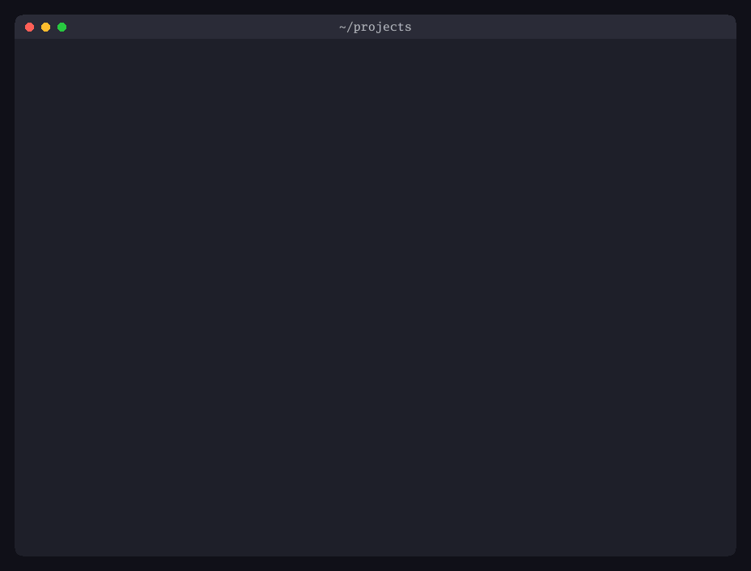

# berthlight

Stable names for devcontainer dev servers, without published ports.

```
http://gallery.localhost:7480           instead of    http://localhost:8089
http://shop-fix-login.localhost:7480                  http://localhost:8083 (or was it 8084?)
```

One proxy, bound to loopback, routes each name to its container over a
per-project container network. No runtime socket, no root, nothing reachable
from the network. The same binary installs an agent skill for Claude Code,
Codex, OpenCode and pi.



*Twelve dev servers in their own devcontainers, each at its own name, coming up one by one in `berthlight status --watch` in Ghostty. Recorded from real containers with [tools/guides](tools/guides). Run `berthlight` on its own for the rest of the show.*

**Status:** early development. See [the PRD](prd/0001-berthlight.md) and #1.

## Install

```sh
brew install stormlantern-dev/tap/berthlight                 # macOS, Linux
scoop bucket add stormlantern https://github.com/stormlantern-dev/scoop-bucket
scoop install stormlantern/berthlight                        # Windows
paru -S berthlight-bin                                       # Arch
```

Debian, Fedora and Alpine packages and plain archives are on each
[release](https://github.com/stormlantern-dev/berthlight/releases). Every
release has checksums signed with cosign and GitHub build provenance; the
release notes say how to verify them. The proxy image,
`ghcr.io/stormlantern-dev/berthlight:<version>`, is signed the same way.

winget is on its way: `winget install Stormlantern.Berthlight` works once
the package is accepted in
[microsoft/winget-pkgs](https://github.com/microsoft/winget-pkgs). Until then,
use Scoop. Releases test the manifests with `winget validate` and
`winget install` and push them to the organisation's fork. A person then
opens the pull request upstream, on purpose: automating it would take a
long-lived user token, which this project does not keep (PRD, R10).

## Use

Wire a project's devcontainer once, in its main worktree:

```sh
berthlight devcontainer shop 8080 --dry-run   # show the change
berthlight devcontainer shop 8080             # make it
```

This edits `devcontainer.json` in place, keeping its comments: the container
joins its own network (`bl-<folder name>`) instead of publishing a port, and
an `initializeCommand` registers the route on the host before the container
starts. Each worktree gets its own name: `shop.localhost` for the main
worktree, `shop-fix-login.localhost` for a worktree in `webshop-fix-login`.
The dev server must listen on `0.0.0.0` inside the container.

```sh
berthlight url              # this worktree's URL (--copy puts it on the clipboard)
berthlight status           # the proxy and every route, and what is wrong if anything is
berthlight status --watch   # keep it on screen; a notification when a route comes up or goes down
```

In a modern terminal (Ghostty, Kitty, WezTerm, iTerm2, Windows Terminal) URLs
are clickable, a small demo scene heads each command (animated in Kitty and
Ghostty, also over SSH, where a slow connection drops frames or gets the
chunky C64 version rather than holding the command up;
`BERTHLIGHT_SCENE=amiga` or `=c64` picks one; `berthlight demo` plays it in
full; `--no-header` leaves it out), and `--watch` shows a summary in the tab title and progress in
the tab while something is down. Piped or redirected, the output is plain
text, and `ls --json` and `status --json` give scripts and agents a stable
format.

### HTTPS on your own domain

For `https://shop.dev.example.com:7480`, with a certificate every browser
trusts and no local CA, use a domain you control. Point
`*.dev.example.com` at `127.0.0.1` (an `A` record, and `AAAA` `::1`) at
your DNS provider, then get a wildcard certificate with the DNS-01
challenge, from Let's Encrypt by default (in nushell):

```nu
$env.BERTHLIGHT_BASE = "dev.example.com,localhost"   # in your config.nu
berthlight down; berthlight up                       # the proxy accepts the new base
berthlight cert --dns gcloud --accept-tos --install-timer   # get it, and renew it daily
```

The first run creates an ACME account with the CA, which means agreeing to
its terms of service: without `--accept-tos` it stops and shows where they
are. Later runs, and the renewal timer, use that account and need no flag.

`berthlight cert` runs on the host and is the only part that sees your DNS
credentials. It reads them as [lego](https://go-acme.github.io/lego/dns/)
does for the provider: from the environment, or from
`~/.config/berthlight/cert.env` (`KEY=VALUE` lines, `chmod 600`), which the
renewal timer reads too. Built in are `gcloud` (Application Default
Credentials, `GCE_PROJECT`, optionally `GCE_IMPERSONATE_SERVICE_ACCOUNT`),
`cloudflare`, `route53`, `digitalocean`, `hetzner`, `dnsupdate` (RFC 2136:
BIND, PowerDNS, Knot), and `exec` and `httpreq` for anything else. `--server
letsencrypt-staging` tries it out first.

The certificate and key go in the state directory, the key readable by you
and the proxy only. The proxy picks them up within a second, serves HTTPS on
the same port 7480, and redirects plain http to https for the names the
certificate covers; `*.localhost` stays on http. `berthlight url`, `ls` and
`status` give https URLs from then on, and `status` says when the
certificate does not verify. A renewal starts when a third of the
certificate's lifetime is left (`--renew-within` to change that); the timer
is a systemd user timer on Linux and a launchd agent on macOS.

Coding agents can do the wiring too. `berthlight skill install` installs a
skill that teaches Claude Code, Codex, OpenCode and pi how, including the dev
server settings, docs and OAuth redirect URIs around it. Add `--project` to
put it in the repository for everyone working on it.

## Development

Open the repository in its devcontainer, or use Go 1.27 on the host:

```sh
go test ./...
go run ./cmd/berthlight url
```

## License

[Apache-2.0](LICENSE)
